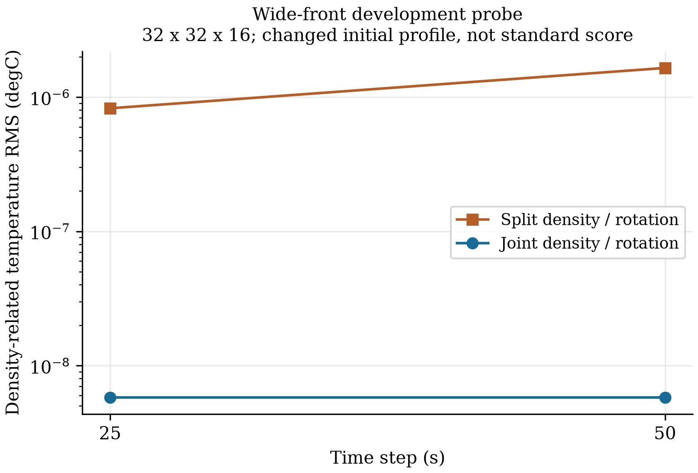

# 密度力与科氏切变的阶段平衡

ZhenMode 将密度压力力和科氏切变放在同一个半步中处理后，制造的离散地转平衡
在中间阶段保持到舍入误差量级。单独的平滑宽锋面开发控制中，密度相关温度误差
在 dt=50 s 时从 1.648685×10⁻⁶ 降到 5.784424×10⁻⁹ °C，缩小约 285.0 倍。
原标准热成风的总温度误差只降低约 1.52%，v 误差略增 0.0518%；这些结果不能混用。
本轮仍是受限通道候选，旧默认路径保留。

## 小诊断

PR63 修正有限海面高度的压力定义后，粗网格密度相关误差仍约为 2.14648×10⁻⁵ °C。
随后的开发控制将锋面宽度从 25 km 改为 50 km，得到全宽的光滑余弦形剖面，
同时改变了流速和梯度尺度。在相同宽锋面中，ny=32、dt=50／25 s 的 B 误差分别为
1.648685×10⁻⁶／8.249475×10⁻⁷ °C；ny=64、dt=50 s 为 1.647707×10⁻⁶ °C。
B=T−(0.779/0.205)(S−35)。这组结果支持检查时间组织，不能单凭它定位唯一原因。

另一个控制直接按离散压力导数构造地转平衡，不替换正式 benchmark 初态。
原分工先单独旋转切变，后在非线性阶段施加密度力。零初始法向速度在第一个
25 s 半步中变为约 1.19801×10⁻⁴ m/s；完整步后的最大 |v| 只有
4.27337×10⁻¹⁰ m/s。完整步的小误差没有揭示中间阶段的输运。

垂向供体通量对相反速度并不反对称。相同线性温度剖面、相反的界面输运 Fz，
平均内部垂向通量为 ½|Fz|(T浅−T深)。实际平均倾向最大为
2.93092×10⁻⁸ °C/s，与独立供体公式的最大差为 1.4228×10⁻²² °C/s；全域库存
倾向仍接近零。这解释了局部变化能够在库存闭合时存在，并为本轮选择提供依据。

## 单模块修改

`density_rotation_scheme='joint_shear'` 将深度平均密度力继续交给原外模，把其余
密度压力力与科氏切变合并到 L 半步。半步内温盐固定，按旋转矩阵的解析积分
处理这项固定力；系数使用 sinc 形式，使 f=0 和小 f 也有稳定的极限。
N 阶段扣除同一定义的三维密度力，保留动量和温盐平流，以免重复计入切变力。

垂向供体输运、水平空间算子、静态水柱容量及线性自由面连续性均未改变。
工厂只接受原有全湿平底笛卡尔、无混合、有限海面密度压力的通道组合，另外要求
float64 和关闭海绵层。固定力半步的解析性质不等于温盐变化时整个耦合模式的
时间精度；风、混合、海冰、真实海岸、物理移动库存和整体能量资格仍未建立。

制造的离散平衡在新半步中的最大 |v| 为 1.8234×10⁻¹⁸ m/s，完整步后为
3.2060×10⁻¹⁸ m/s，温度数组没有变化。该控制与正式算例共享 EOS 和空间算子；
固定力旋转的正、负、零 f 闭式解及故意省略力的反例提供另外的实现检查。

## 原标准对照

十次正式 float64 CUDA 运行包含九个新选项和一个同包旧热成风控制，全部通过
原有筛选。五组周期驻波和三级旋转波的全部原生数组与 PR63 相同；同包旧热成风
也完整复现 PR63 数组，新旧六个初态数组相同。全部原生格点、权重、参考及阈值保留。

| 热成风指标 | PR63 分开处理 | 联合切变处理 |
| --- | ---: | ---: |
| 海面相对误差 | 0.0006679224071 | 0.0006677836272 |
| u 相对误差 | 0.0003082137655 | 0.0003077233290 |
| v 相对误差 | 0.0001969874851 | 0.0001970895172 |
| 温度误差，°C | 0.00002174985565 | 0.00002141911306 |
| 盐度误差，psu | 0.0000009236644281 | 0.0000009223497669 |
| 温度库存相对变化 | 3.1733×10⁻¹² | 1.8102×10⁻¹² |

B 误差从 2.146477693×10⁻⁵ 变为 2.113040170×10⁻⁵ °C，密度中性温度等效
误差从 3.509924827×10⁻⁶ 变为 3.504929114×10⁻⁶ °C。原锋面只有有限光滑性，
其余离散与参考差异尚未分离；阶段平衡修正没有解决原算例的主导误差。
库存数值是既有节点／海面诊断量，接近舍入误差的比值不用于宣称物理预算改善。

## 平滑开发控制

本轮另外完成两次宽锋面 CUDA 运行；它们改变了初态，单独保存，不经过原标准
评分器。新旧宽锋面的初态数组逐项相同，旧值来自此前独立安装包的诊断。

| 宽锋面配置 | 旧 B RMS，°C | 新 B RMS，°C |
| --- | ---: | ---: |
| ny=32，dt=50 s | 1.648684762×10⁻⁶ | 5.784424271×10⁻⁹ |
| ny=32，dt=25 s | 8.249475436×10⁻⁷ | 5.784408894×10⁻⁹ |



新结果在这两个时间步下几乎相同，说明原有显著的时间步响应已减弱。两个点不足以
确认整个模式的时间收敛阶，也不能把宽锋面的约 285 倍改善写成原标准热成风的改善。
本轮共十二次原生运行，十次正式对照与两次开发控制分别计数。

## 检查与来源

283 项有界 CPU 检查通过，覆盖固定力旋转、零力回归、深度平均不变、各阶段与
完整步的离散平衡、三维力分工、全状态重启，以及评分、架构和完整源码身份。
功能提交为 `5b4255a23acc66d8ef24f13b2ed8973b425d0fdd`，实际积分来自独立目录
安装的 wheel，使用 RTX 4060 Laptop、CUDA、float64；每个 worker 保留
1 CPU／600 s／4 GiB 采样进程组 RSS 预算。功能提交上的完整 CI 38114625889
已完成：1544 项测试通过，MMS 为 ALL PASS；后续报告提交仅改变文档与证据。

[数值、控制与哈希](data/balanced_density_rotation_20261011.json)保留十二次运行收据、
新旧阶段控制、同包比较和宽锋面诊断。此前结果参与了本轮选项选择，全部属于开发
证据，不作工业资格或性能结论。原始结果位于 `outputs/balanced-density-rotation-20261011/`，
此前的宽锋面探针位于 `outputs/thermal-front-probe-20261011/`。

```bash
zhenmode benchmark channel --case thermal-wind --method balanced-density-rotation \
  --models zhenmode --output NEW_THERMAL \
  --source-revision 5b4255a23acc66d8ef24f13b2ed8973b425d0fdd
```
