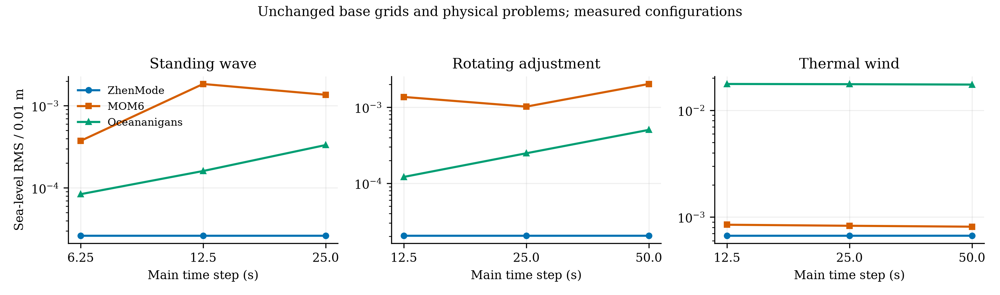

# 三模式设置比较结果

调整已有设置后，两套对照模式的部分成绩改善，原先的差距缩小。ZhenMode 的时间步
减半与再减半对驻波和热成风误差影响较小；热成风的水平网格加密更有效。
原计划 65 条全部尝试，64 条完成并通过原筛选，1 条 MOM6 加密设置失稳。
失败后单独增加 1 条网格与步长组合，也完成并通过筛选：本轮总计 66 次原生尝试，
65 次完成、1 次失败。动力核心没有修改，旧默认设置保留。

## 同网格下的设置比较

下表每个模式、每个算例选择已测且通过原筛选的海面误差最低行，并保留该行的
完整误差，不拼接不同设置的最低值。驻波网格为 256×8×4、旋转调整为
8×256×4、热成风为 32×32×16。不同模式可选不同时间步与既有数值设置。
海面误差除以原预置 0.01 m；u／v 按各算例预置速度尺度归一化。驻波 u 为深度
平均，其余为三维体积加权；温盐为绝对 RMS。数值按八位有效数字向上显示。

| 算例 | 模式 | 设置 | 海面误差 | u 误差 | v 误差 | 温度 RMS（°C） | 盐度 RMS（psu） |
|---|---|---|---:|---:|---:|---:|---:|
| 驻波 | ZhenMode | dt-quarter | 0.000026168741 | 0.000023202398 | — | — | — |
| 驻波 | MOM6 | dt-quarter | 0.00037416814 | 0.00021101318 | — | — | — |
| 驻波 | Oceananigans | dt-quarter | 0.000083937278 | 0.000085092225 | — | — | — |
| 旋转调整 | ZhenMode | dt-quarter | 0.000020388599 | 0.000013052889 | 0.000017963882 | 0 | 0 |
| 旋转调整 | MOM6 | mom-less-damping | 0.00055578935 | 0.0012815139 | 0.0024742354 | 3.7803074E-14 | 6.9419952E-14 |
| 旋转调整 | Oceananigans | dt-quarter | 0.00012123079 | 0.000045682892 | 0.000072455283 | 1.8217492E-14 | 7.2896838E-14 |
| 热成风 | ZhenMode | dt-quarter | 0.00066737742 | 0.00030772327 | 0.00019708927 | 0.000021419404 | 9.2234985E-7 |
| 热成风 | MOM6 | base | 0.00081156625 | 0.00091887128 | 0.00076641910 | 0.00020441055 | 0.000020450102 |
| 热成风 | Oceananigans | base | 0.017427674 | 0.00092617942 | 0.00091851471 | 0.00019171467 | 0.0000055625585 |

`dt-quarter` 是总步长减至原来的 1/4：驻波为 6.25 s，其余为 12.5 s。
`mom-less-damping` 保持原总步长，把海面计算步长减至 1/4，开启原生 RK2B
平均速度交换，并将 BEBT 从默认 0.1 改为 0.06。它在旋转调整中减小海面误差，
却增大 u／v 误差；这条行只代表海面指标最低的组合，不代表所有指标最优。

曲线只连接三个实测配置，没有拟合收敛阶或添加误差条。MOM6 的驻波步长
从 25 s 减至 12.5 s 时，海面误差从 0.001361678 增至 0.001842502，而能量
变化减小；再减至 6.25 s 时，海面误差为 0.0003741682。轨迹误差并不单调，
本批没有逐项分离造成该变化的因素。原生驱动明确对分数秒步长使用实数主时钟。
ZhenMode 的驻波海面误差在三点均约为 2.618×10⁻⁵，但能量变化仍随步长缩小。

## 热成风的温盐设置

同一 32×32×16 网格上，按温度 RMS 最低选择另一个代表行；海面最低与温度
最低可能属于不同设置。完整指标向量保存在机器可读结果中，原计划摘要表另列海面与温度。

| 模式 | 温度最低的设置 | 温度 RMS（°C） | 盐度 RMS（psu） | 海面误差 |
|---|---|---:|---:|---:|
| ZhenMode | base | 0.000021419114 | 9.2234977E-7 | 0.00066778363 |
| MOM6 | mom-ppm-h3 | 0.00020056717 | 0.000017626809 | 0.00084031976 |
| Oceananigans | oa-weno5 | 0.00019090986 | 0.0000032786891 | 0.017428309 |

`mom-ppm-h3` 在较小海面步长与 RK2B 下使用原生 PPM:H3；`oa-weno5` 在请求
16 个海面子步下使用 WENO5。它们是配置组合，本批不把收益归给单一选项。
Oceananigans 请求 8／16／32 子步时，实际分别使用 5／11／23 个加权子步；
实际步长比例、主输运方案和边界备用方案分别记录。

## 网格与步长配套

原 MOM6 加密行在 64×64×16、DT=DTBT=50 s 下出现海面低于 −100 m 海底，
并报告 135786750 次速度截断，最终 FATAL／MPI_ABORT。它保留为原计划第 51 行，
没有转换成可评分的成功成绩。追加组合保持网格、DT=50 s 和 RK2B=False，
只将 DTBT 改为 12.5 s，随后完成并通过原筛选。

三方已经测过的 64×64×16 配置如下；这不是在加密网格上完成了全部设置扫描。

| 模式／组合 | 海面误差 | u 误差 | v 误差 | 温度 RMS（°C） | 盐度 RMS（psu） |
|---|---:|---:|---:|---:|---:|
| ZhenMode，加密 | 0.00017069463 | 0.000096126491 | 0.000063879993 | 0.000010246069 | 2.8323540E-7 |
| MOM6，加密＋较小海面步长 | 0.00020912199 | 0.00023201471 | 0.00019135866 | 0.000049863568 | 0.0000054998250 |
| Oceananigans，加密 | 0.017198122 | 0.00024882992 | 0.00053033571 | 0.000046150275 | 0.0000015484554 |

ZhenMode 水平加密后的温度误差从 2.141912×10⁻⁵ 降至 1.024607×10⁻⁵ °C。
只增加垂向点数至 32 时为 2.066844×10⁻⁵ °C；只缩短时间步没有降低温度误差。
这组结果支持优先检查原锋面的水平离散与平衡误差，尚未定位唯一原因。

## 来源与适用范围

原 65 个合同身份和评分阈值在扫描中保持不变，各模式保留原生点值／层平均及
垂向表示。[原计划摘要](configuration_scan_all_rows_zh.md)保留 65 条的网格、步长、
海面／温度误差、失败和 worker 墙时；[数值与身份](data/configuration_scan_20261011.json)保留
完整指标向量、原生参数、哈希、三方原设置的 17 数值数组复现及追加组合。
选择规则在首批试跑后、其余设置扫描前单独记录；全部属于开发数据。

最先执行的 10 条（序号 0、5、9、10、12、17、42、53、61、64）使用功能提交
8fe4748，剩余原计划行使用 87a47a3；两者只在方案读回
核查上有差异，已跑的四条 Oceananigans 方案记录也通过更严格的重查。
追加组合来自 76fe2c6。MOM6 的程序与固定作者源码为既有缓存，历史完整构建
来源仍有缺口；作者版本和实际程序哈希分别保留。

ZhenMode 与 Oceananigans 使用 RTX 4060 Laptop、CUDA、float64；MOM6 使用
一核 CPU。每个原生 worker 使用 600 s 时限和 4 GiB 采样进程组 RSS 阈值，
GPU 分配器比例不是整个设备的硬限额。ZhenMode 初始化含显式编译时间，并另存
该编译字段；Oceananigans 的初始化／循环包含相应 JIT，MOM6 的缓存程序计时
不包含构建。不同硬件和这些计时范围不提供方法速度排名。

157 项相关有界检查通过，后续追加配置另有 87 项检查通过；两批有重叠，不相加。
最终功能提交 76fe2c6 的完整 CI38126232698 为 1562 项通过，MMS 为 ALL PASS。
原始文件在本机 outputs/configuration-scan-20261011/，包括失败日志与追加计划。
这些受控算例已参与方法选择；新结果没有授予独立 SOTA、工业或全球气候资格。
