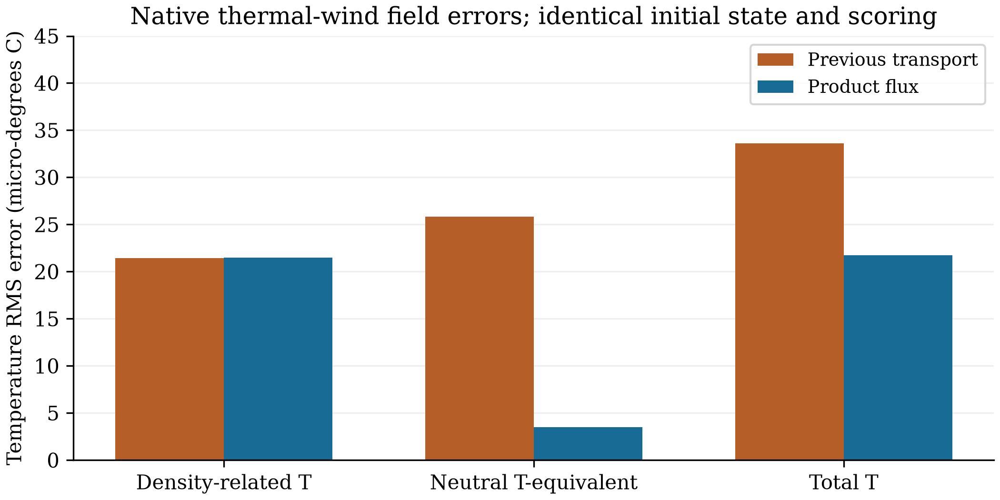

# 通道示踪物乘积通量

ZhenMode 在相同热成风初态和评分下采用守恒乘积通量后，盐度误差从
6.803831×10⁻⁶ 降到 9.236771×10⁻⁷ psu，缩小约 7.366 倍；温度误差从
3.359612×10⁻⁵ 降到 2.174987×10⁻⁵ °C，缩小约 1.545 倍。
密度相关温度误差未改善，海面与流速指标也小幅增加。新选项作为受限通道候选
保留，原生产预设和已有默认路径不变。

## 小诊断

上一轮已经提高压力与水量通量的空间模板，示踪浓度仍由相邻格点平均构造。
在 U=0.05 m/s 的均匀周期流中，nx=16、32、64 的示踪导数相对误差分别为
0.02550464、0.006413149、0.001605607；实测离散符号与 sin(kΔx)/Δx 一致。
该独立解析控制支持修改水平示踪通量；它不证明完整热成风中的盐度误差全部
来自输运相位，因为实际流场本身也有误差。

按本算例的线性密度律，B=T−(0.779/0.205)(S−35) 表示密度相关温度。
相同体积和时间权重下，旧温度误差可拆成 B 的误差、密度中性温度等效误差及
交叉项：前两者 RMS 分别为 2.145323×10⁻⁵ 和 2.585456×10⁻⁵ °C。
这些是场的代数组合，不是独立的因果误差份额。独立程序直接计算解析锋面和
点值输运参考，检查平方项与交叉项能够复合成原温度误差。

## 单模块修改

`tracer_transport_scheme='product_fourth'` 先在格点构造 uT 和 vT，再使用上一轮
通道模板重建守恒面通量。这样在变速流中也可微分完整乘积；分别重建速度和浓度
后相乘一般不能保留同一空间关系。若调用者提供额外水量面通量，增量携带中心
浓度，使常量示踪物继续服从实际水量通量；这部分增量的阶数单独保留。

工厂只接受已限定的全湿平底笛卡尔四阶压力／连续性通道，并拒绝单调或 FCT
限制器组合。插值系数有正负号，可能产生锋面过冲，不具备一般单调性或稳定性
保证。垂向仍使用原供体输运，时间组织也不改变，因此不构成完整模式四阶或
真实海岸／混合／海冰资格。原初态、全部评分格点、权重和阈值保持一致。

## 同台复测

本轮 11 次原生 CUDA 运行全部完成并通过原有筛选：九次新选项运行，以及同包
的上一轮热成风和细网格旋转波控制。两个旧控制全部原生数组复现上一轮结果，
新旧初态数组相同。五个周期驻波和三个旋转波的新结果也与上一轮全部原生数组
完全相同；这里的完全相同由逐数组核对得到。

| 热成风指标 | 上一轮通量 | 乘积通量 |
| --- | ---: | ---: |
| 温度误差，°C | 0.00003359612 | 0.00002174987 |
| 盐度误差，psu | 0.000006803831 | 0.0000009236771 |
| 海面相对误差 | 0.0006686848135 | 0.0006686850872 |
| u 相对误差 | 0.0003082169578 | 0.0003082176199 |
| v 相对误差 | 0.0001969913880 | 0.0001969915232 |
| 温度库存相对变化 | 3.1737×10⁻¹² | 3.1818×10⁻¹² |



新 B 误差为 2.146478×10⁻⁵ °C，较旧值略增；密度中性温度等效误差降到
3.509973×10⁻⁶ °C。总温度误差现在主要受密度相关部分限制，继续提高示踪物
空间阶数不能保证进一步显著改善。海面和流速的微增、温度库存变化也保留在表中，
没有把通过筛选写成所有指标都改善。交叉项仍很小，完整数值在 JSON 中保存。

## 验证与来源

256 项有界 CPU 检查通过，包含均匀流解析符号、变速乘积导数、修正面通量下的
常量示踪物与库存关系、全核心 RK2 输运解、严格重启，以及完整架构／源码身份
检查。完整 CI 和 MMS 在功能提交 `3d573a308f76eba3482de881e67e68767e121286`
上通过，运行编号为 38073467922。

正式积分来自独立目录安装的 wheel，采用 RTX 4060 Laptop、CUDA、float64，
每次保留 1 CPU／600 s／4 GiB 采样进程组 RSS 预算。实际新增逻辑属于已经登记
的通道文件，收据包含该文件完整哈希。此前结果参与了选项选择，本轮仍属于
开发证据，不是独立工业认证或性能比较。[数值、分解与哈希](data/tracer_product_20261011.json)
对应原始输出 `outputs/tracer-transport-20261011/`。

```bash
zhenmode benchmark channel --case thermal-wind --method fourth-order-transport \
  --models zhenmode --output NEW_THERMAL \
  --source-revision 3d573a308f76eba3482de881e67e68767e121286
zhenmode benchmark standing-wave --study 256 25 --method fourth-order-transport \
  --models zhenmode --output NEW_WAVE \
  --source-revision 3d573a308f76eba3482de881e67e68767e121286
```
